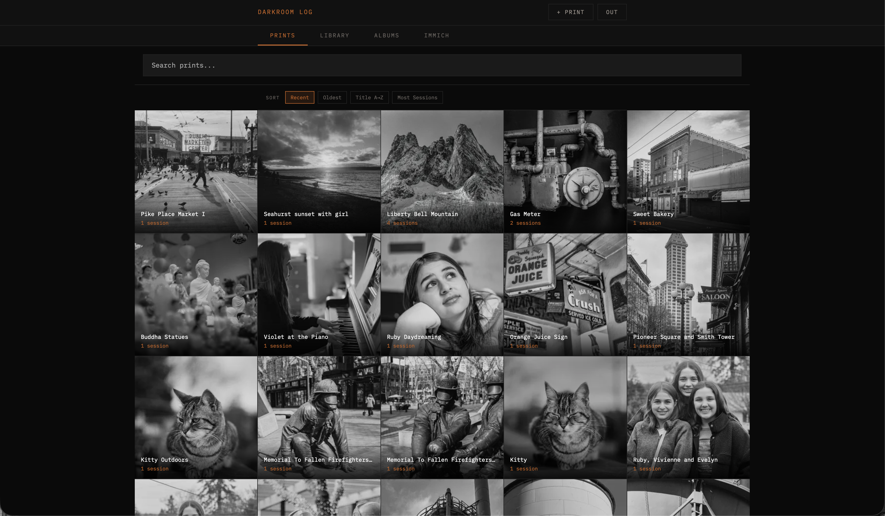

# Darkroom Log

A self-hosted darkroom printing log and analog photo library, built for Immich integration.



Each print page records full exposure data (shutter / aperture / ISO / lens), tags, every print
session you've made of it (paper, enlarger, lens, exposure, dodge/burn notes), and chips for any
album the print belongs to so you can jump straight to that album from the print itself.


Albums double as **public, shareable galleries** — each gets its own URL with a custom branded
header, optional slideshow, and pinch-zoom on every photo. No login required for viewers.


## What's new in v1.5.135–142

Name the people in your photos without leaving Darkroom, and a few fixes.

- **Name faces from a photo's details.** The People row shows a crop of every face Immich found. Click one to name it: existing people are suggested, any capitalisation reuses the same person, and a new name creates the person in Immich. For a face Immich grouped but never named, one save can name every photo of that face, and if the name already exists the group is merged into that person. **Hide** hides a stranger's group in Immich. Everything goes through the Immich API and can be undone in Immich.
- **Add a face Immich missed.** The "Add face" tile at the end of the People row lets you drag a box around a face, with a mouse or a finger, and name it. Immich stores it as a manually added face.
- **"Not yet named" and "Hide named"** in the People filter. "Not yet named" lists only photos with faces nobody has named yet, including faces Immich never grouped, which don't appear on Immich's own People page. "Hide named" leaves out every photo where someone is named, in any search or filter. For example, a ✦ Smart search for "person" with Hide named on finds people Immich didn't detect. Both need read-only database access (see below). Naming and adding faces work without it.
- **Fixed: a photo's Albums row could be empty** after logging in, so a photo already in an album looked as if it was in none. The row now waits for the album list and says "Couldn't check albums" if that fails.
- **Fixed:** "Add to album" sometimes showed "No albums yet"; the grid jumped to the top after naming someone while Hide named was on; and the People row had no divider line above Tags.

**Database access for "Not yet named" and "Hide named":** these read Immich's database through the optional least-privilege role described in the changelog (`.immich-db-creds.json`). That role needs read-only access to a few more columns:

```sql
GRANT SELECT ("id","ownerId","deletedAt","visibility","localDateTime") ON asset TO darkroom_svc;
GRANT SELECT ("assetId","personGroupId","deletedAt","isVisible") ON asset_face TO darkroom_svc;
GRANT SELECT ("personGroupId","ownerId","name","isHidden") ON person TO darkroom_svc;
```

If your Immich API key is scoped to specific permissions, face naming and Add face also need `face.read`, `face.create`, `face.update`, `person.read`, `person.create`, `person.update`, `person.merge`, `person.statistics` and `person.delete`. The last one only removes a just-created person left with no faces after Immich refuses a face.

## What's new in v1.5.129–134

Search behaves the same everywhere, Clear really clears, and archived photos stay archived.

- **Clear resets the search completely.** In the main library, the search panel's Clear and the ✕ in the search box now reset everything. That covers the text, filters, the person, the People name filter, and a tag search opened from a photo's details along with its "Tag: …" title. They also cancel a search that is still loading, so its results can't fill the grid after you've cleared it, and Load More goes back to loading the library.
- **Fixed: archived photos came back on refresh.** The main library's "All" view keeps a 5-minute copy of the library list, and Archive and Restore weren't clearing it. Photos were archived in Immich straight away, but a quick refresh showed them again until the copy expired. Archive and Restore now clear it.
- **One search mode, remembered.** The Text / ✦ Smart choice is shared between the main library and the album views, and kept after a reload.
- **Switching search mode keeps your filters.** Changing between Text and Smart in the main library keeps your Camera, Lens, place and People filters and re-runs the search, as album views already did. The ✕ in the search box appears whenever a filter is set, not only after typing, since it clears everything.
- **Album views tidied to match the main library:** the Search Mode layout in the panel, the selection tick, grid width, the panel's Clear button, search timing, the active-filter label and the empty-results message.

## What's new in v1.5.122–128

Digital photos get first-class treatment, search reaches inside albums, and Archive works again on Immich v3.

- **Fixed: Archive and Restore did nothing on Immich v3.** v3 replaced the asset's `isArchived` flag with `visibility`, and silently ignores the old field while still answering success, so a photo archived from Darkroom vanished on screen and came back on refresh. Darkroom now sends `visibility`, and the detail page correctly shows Restore on archived photos.
- **Camera tabs and album search.** Albums you pin (by name, in `PINNED_ALBUMS`) get their own tab in the header, for example one album per digital body kept out of the main library. Inside any album, search now has a **Text / ✦ Smart** toggle using the same search as the main library (titles, tags, places, gear, filenames; or CLIP "describe a scene"), scoped to that album and including archived photos. Text mode also matches any part of a lens or camera name, which Immich's own metadata search can't. The old Digital tab is now **Archive**.
- **Album views match the main library.** Pinned camera tabs and every album now use the same search bar and menus as the main library: one search box that opens the panel (Search Mode, Select, Camera / Lens / State / City, People with face avatars), a Sort chip (Upload Date, Date Taken, Last Edited), and the select toolbar in the same row.
- **People in the photo details.** Everyone Immich's face recognition found in a photo is shown with their face in the detail column (people hidden in Immich are left out).
- **Archive from multi-select.** Select several photos in the main library and archive them in one go.
- **Tags & Captions for digital photos.** Photos without the film description (`Camera | Film | Developer | Lens`) are treated as digital: camera and lens come from EXIF, a black-and-white frame is detected from the image itself, and film-only tags and hashtags are left out. Film scans are unchanged. Lightroom workflow keywords (anything ending `-immich`, and `flickr-pool`) are no longer treated as photo tags.
- **Several title suggestions.** The title generator offers five ideas drawn from both the tags and the image, refreshes when you edit the title, and rebuilds the captions with the new title.

## What's new in v1.5.118–121

A tag-loss fix and a security pass. `npm audit` is now clean.

- **Fixed: pasting several tags onto a Library photo could silently lose one of them.** Linking tags one call at a time triggers a race in Immich's sidecar writes (upstream immich#32306, present in v3.2 and v3.3) that can delete a tag after its link call reported success. A pasted list is now linked in a single Immich call. The one-click suggested-tag chips still add one tag at a time.
- **sharp 0.33.5 → 0.35.5**, picking up libvips, libheif and librsvg security fixes. Rendered output was compared before and after on real photos: byte-identical in 25 of 28 renders, the rest not visibly different.
- **Patched advisories in `compression`** (memory leak when a client drops a compressed response early) **and `proxy-addr`.**
- **Login rate limit hardened.** Forwarding headers are now believed only from a trusted proxy (the `cloudflared` container by default; override with the new optional `TRUSTED_PROXY_HOSTS`). Previously a client reaching the app without going through Cloudflare could send a made-up header on each attempt and never be limited. **If you run behind a different reverse proxy, set `TRUSTED_PROXY_HOSTS` to it**, otherwise all clients share one login-attempt bucket (10 per 15 minutes).

## What's new in v1.5.114–117

Security hardening plus a handful of fixes.

- **Breaking: `APP_PASSWORD` (or `PASSWORD_HASH`) is now required.** The server refuses to start if neither is set, instead of silently falling back to a built-in default password. If you already set one, nothing changes.
- **Patched dependency DoS advisories** in express, body-parser, qs and multer.
- **Fixed: the "+ Album" picker didn't move the album you'd just added to back to the top until a page reload.** It now updates immediately. Removing, reordering and renaming also keep the Albums tab's "Recently updated" sort current. The picker's Immich-albums tab is now sorted by most recently updated too.
- **Fixed: the Analog tab's Sort button did nothing, and the Prints tab could get stuck on "Loading..."** when Analog was the default tab.

## What's new in v1.5.109–113

Renamed the Library/Immich tabs to match what's actually in them, plus a mode-toggle and Prints sort cleanup.

- **Renamed tabs: Library → Analog, Immich → Digital** — the old names didn't reflect content. "Analog" is film work exclusively; "Digital" is digital-camera work (organized into Immich's native albums), once cleared of redundant film-scan albums now covered by this app's own Albums tab.
- **New Print/Analog mode toggle** in the header — swap which of Prints/Analog opens first and reads first in the tab bar, since the right default depends on whether you're printing or working through scans that day. Persisted, so it's a one-time flip.
- **Prints tab's Sort** is now a compact dropdown at the end of the search bar instead of an always-visible button row, matching the Analog tab's existing pattern.

## What's new in v1.5.104–108

Library tag-add bug fixes plus a dedicated title regenerate button.

- **Fixed: pasting a multi-word tag list into a "+ tag" input shredded every tag into single words** — the paste handler split on any whitespace instead of just commas. Multi-word tags (e.g. "black and white film") now paste correctly, and slashes are stripped from Library tags to avoid Immich's nested-tag-hierarchy parsing (`f/2` → `f2`).
- **Fixed: a tag could silently fail to link with no error shown** — the server now verifies each tag-link write actually succeeded against Immich's real per-item result before reporting success, instead of assuming success whenever the request didn't throw.
- **Fixed: the Library tags row often needed a manual page reload to show a just-added/removed tag** — it now updates from the write the client already knows succeeded, instead of immediately re-reading Immich (whose read-after-write isn't always immediate).
- **New: dedicated "regenerate" button for just the suggested title** — get a fresh title idea without re-running the whole caption/tag generation.

## What's new in v1.5.102–103

- **Album picker sorts most-recently-used first** — the "+ Album" picker now surfaces whichever album you were just filing photos into, instead of an unsorted list.
- **Fixed: Immich albums appearing empty when opened** — Immich v3.1.0 stopped including an inline asset list on its album-detail endpoint; the proxy now fetches it separately via search and merges it back in.

## What's new in v1.5.101

- **Library-tab title and tag editing** — the Tag & Caption generator's suggestions can now be saved directly onto Library photos, not just Prints. Tag edits write real Immich tags; titles are tracked separately and survive the periodic IPTC byte-scan.
- **AI-suggested titles** — the generator now proposes a short, evocative title for untitled photos alongside its tag suggestions.
- **Public album date fix** — photo dates/times on public albums could render several hours off the actual capture time due to a local-vs-UTC mismatch; fixed.
- **Library chip-filter fix** — filtering the Library by a Lens/Camera/City/State chip no longer wipes the grid to "No recent uploads." when re-entering the Library tab.

## What's new in v1.5

- **In-Albums chips on every print and Recent photo** — see at a glance which Darkroom albums each image is in; click to jump straight to the album.
- **Public album detail view** — tapping a thumbnail in `/album/<slug>` opens a library-style two-column layout with EXIF (description, date, camera, lens, location), separate from the fullscreen Ken Burns slideshow.
- **Pinch-zoom fullscreen viewer** — public album fullscreen is now image-only with 1×–5× pinch, pan-when-zoomed, double-tap toggle, swipe-down to close. Trackpad two-finger swipe-up also closes.
- **Album metadata API** — expanded `/api/public/photo/:id` returns full EXIF (make, model, lens, focal length, shutter, aperture, ISO, date, city/state/country) for the public viewer. GPS lat/long never leave the server.
- **Mobile Load More smoothness** — fixed cumulative scroll drift across multi-page library loads; fast-path append now keeps the DOM above untouched.
- **Session arrow-key fix** — opening "+ Session" no longer leaks left/right arrows into print navigation, so sessions can't accidentally land on the wrong print.
- **Lazy-loaded albums** — opening a print or Recent photo before visiting the Albums tab no longer silently shows zero album chips; albums fetch on demand.

See [CHANGELOG.md](CHANGELOG.md) for full version history.

## Features

### Prints
- Log darkroom print sessions with exposure data, paper, technique, notes
- Split-grade and single-grade workflow support
- Tag filtering and session history per print
- Link prints to Immich photos via EXIF search

### Library
- Browse your full Immich photo library
- Sort by upload date or date taken (ascending/descending)
- **Combined search** — merges Immich text search and CLIP smart search into a single result set, something Immich's native UI doesn't offer
- Search by recognized person/face
- Filter chips: camera, lens, location, people
- **Compose filters** — person, chip, and text/smart search intersect server-side (e.g. "Ruby + Anacortes + 'beach'" returns only photos matching all three)
- Select mode with shift-click range selection

### Albums
- Create curated albums from your Immich library
- Drag-to-reorder photos
- Select and download originals with original filenames
- Shareable public links

### Immich Albums
- Browse your Immich albums as a grid
- **Sort photos by upload date or date taken** — a feature missing from Immich's native album view
- Filter by camera, lens, or location within an album
- Select mode with shift-click range selection
- Add Immich photos directly to Darkroom albums
- Full photo detail (EXIF, map, fullscreen, download, share)

### Slideshow
- **Smooth Ken Burns pan/zoom** — linear motion with no mid-cycle jumps or snap-back artifacts
- Title card with byline and photo count; circular play button to start
- Background music with fade-in; pause/resume synced to slideshow state
- Description overlay, fullscreen (`⤢`), auto-hide controls with mousemove keep-alive
- Swipe down to close; swipe left/right to navigate

### Performance
- **Fast library open** — photo metadata is folded into the initial `/api/immich/recent` response instead of fetched one-asset-at-a-time, so filter chips and search are ready immediately (~1s over a phone connection vs the ~60s an N+1 pattern would cost)
- **Right-sized thumbnails** — grid uses Immich's small thumbnail (~50 KB); detail view uses the 1440 px preview (retina-sharp); full original loads only when you tap to fullscreen
- **Progressive upgrade in detail view** — preview paints instantly, original quietly swaps in after a 400 ms dwell, and rapid navigation cancels the pending upgrade so swiping through photos doesn't waterfall megabytes of originals
- Service-worker-cached thumbnails survive app shell updates (`darkroom-thumbs-v1` cache, FIFO-bounded to 500 entries for iOS Safari quota)

### Mobile & PWA
- Fully responsive — designed and tested on iPhone
- Install to home screen via Safari → **Add to Home Screen** for a native app-like experience
- Runs as a standalone app — no browser chrome, no address bar
- Swipe gestures, tap zones, and smooth animations throughout

### Navigation & Gestures
- Swipe down in any photo detail to go back
- Swipe left/right (or tap edge zones) to navigate prev/next
- Scroll position preserved when opening and closing photos — no flash to top
- Keyboard: arrow keys and ESC work throughout

### Public Album
- Public album page (`/album/:slug`) — no login required, opens directly to slideshow
- **Configurable branded header** — brand name + site link (set via env vars) with inline slideshow button
- **Grid view** — click any photo to open it in a paused single-image view with Ken Burns zoom
- Rich link cards on Substack, iMessage, and social — OG meta tags injected server-side
- Embed in Squarespace, Substack, Webflow, or any iframe (`?embed` hides header)
- Swipe down to close slideshow; swipe left/right to navigate
- Safari and mobile compatible

## Security
- A+ security score (115/100, 10/10 tests)
- CSP: no `unsafe-inline` in script-src
- External JS with comprehensive event delegation
- Login rate limiting (10 attempts / 15 min per IP)
- HSTS, Referrer-Policy, X-Frame-Options, Permissions-Policy

## Requirements

- [Immich](https://immich.app) instance with API access
- Docker + Docker Compose

## Quick Start

```bash
git clone https://github.com/jaapjan14/darkroom-log
cd darkroom-log
cp docker-compose.yml docker-compose.override.yml
# Edit docker-compose.override.yml with your settings
docker compose up -d
```

## Configuration

| Variable | Required | Description |
|---|---|---|
| `APP_PASSWORD` | yes | Login password |
| `SESSION_SECRET` | yes | Random secret for session signing |
| `IMMICH_URL` | yes | Immich API URL e.g. `http://192.168.0.10:2283/api` |
| `IMMICH_KEY` | yes | Immich API key |
| `BRAND_NAME` | no | Public album header brand name (e.g. `Your Name Photography`). Leave blank to hide the brand block. |
| `BRAND_URL` | no | Public album header link destination (e.g. `https://yourdomain.com`) |
| `BRAND_SITE_LABEL` | no | Text shown next to the brand name (e.g. `yourdomain.com ↗`) |
| `CSP_FRAME_ANCESTORS` | no | Space-separated origins allowed to embed `/album/:slug` beyond `'self'`. Example: `https://*.squarespace.com https://*.substack.com` |
| `TRUSTED_PROXY_HOSTS` | no | Comma-separated hostnames or IPs of reverse proxies whose forwarding headers (`cf-connecting-ip`, `x-forwarded-for`) are believed for login rate limiting. Default `cloudflared`. If you run behind another proxy (nginx, Traefik, Caddy), set this to it, or all clients share one login-attempt bucket. |

## Volumes

| Path | Description |
|---|---|
| `/data` | Prints database and filter cache |
| `/music` | MP3 files for slideshow music (optional) |

## Music

Drop MP3s (or folders of MP3s) into the `/music` volume. They'll appear in the slideshow settings dropdown automatically.

## Public Album Embed

```html
<iframe 
  src="https://your-darkroom.domain/album/your-album-slug?embed"
  width="100%" 
  height="350px" 
  frameborder="0"
  allowfullscreen>
</iframe>
```

## Changelog

See [CHANGELOG.md](CHANGELOG.md)

## Credits

Designed and maintained by [JJ Lakatua](https://lakatua.me) — analog photographer and homelab enthusiast — in collaboration with [Claude](https://claude.ai) by Anthropic.

This project was built through an ongoing human-AI collaboration. JJ provided the vision, domain expertise, testing, and direction. Claude assisted with architecture, implementation, and debugging across multiple sessions.
